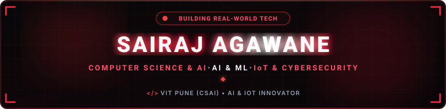
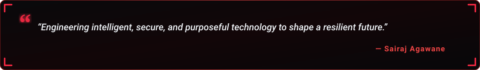

  

  

  
  &nbsp;
  
  &nbsp;
  
  &nbsp;
  
  &nbsp;
  
  &nbsp;
  
  &nbsp;
  

  

---

<h2 align="center">🔴 About Me</h2>

  

  

  Hey! I'm <b>Sairaj Agawane</b>, a passionate <b>Computer Science and Artificial Intelligence student &amp; developer</b> based in Maharashtra, India. 
  Currently pursuing B.Tech in CSAI at <b>Vishwakarma Institute of Technology (VIT), Pune</b> (Direct Second Year) with an academic foundation in <b>Diploma in Information Technology</b>. 
  I specialize in architecting intelligent systems, training machine learning models, deploying embedded IoT hardware, and designing secure, automated Industry 4.0 solutions to solve practical real-world problems.

  
  &nbsp;
  
  &nbsp;
  

  💬 <b>Let's Discuss:</b> Python, Machine Learning, IoT, ESP32, Java, C++, Cybersecurity, Computer Vision &amp; Automation. 
  ⚡ <b>Philosophy:</b> <i>"Engineering intelligent, secure, and purposeful technology to shape a resilient future!"</i>

<table width="100%" border="0" align="center">
<tr>
<td width="50%" align="center" style="padding: 14px;">
  <h4>🔭 Flagship Project</h4>
  
<a href="https://github.com/SairajAgawane" target="_blank"><b>Intelligent Predictive Maintenance</b></a> AI in Industry 4.0 &amp; IoT Anomaly Detection

</td>
<td width="50%" align="center" style="padding: 14px;">
  <h4>🌱 Active Deep Dives</h4>
  
<b>Computer Vision &amp; Machine Learning</b> Cybersecurity Fundamentals &amp; Edge IoT

</td>
</tr>
<tr>
<td width="50%" align="center" style="padding: 14px;">
  <h4>🏆 Key Achievements</h4>
  
<b>DipNova-2026 (1st Rank · ₹50,000)</b> Winner Technovision-2K26 (₹10,000)

</td>
<td width="50%" align="center" style="padding: 14px;">
  <h4>🤝 Collaboration</h4>
  
<b>AI, Machine Learning &amp; IoT Systems</b> Open to internships &amp; impactful projects

</td>
</tr>
</table>

---

<h2 align="center">🎓 Education</h2>

<table width="100%" border="0" align="center">
<tr>
<td width="50%" align="center" style="padding: 14px;">
  <h4>🏛️ Bachelor of Technology (B.Tech)</h4>
  
<b>Vishwakarma Institute of Technology (VIT), Pune</b> 
  Computer Science and Artificial Intelligence (CSAI) · Direct Second Year Admission

</td>
<td width="50%" align="center" style="padding: 14px;">
  <h4>📜 Diploma in Engineering</h4>
  
<b>MSBTE / SVPM's Institute of Technology &amp; Engineering</b> 
  Information Technology · Strong foundation in Programming, Networking &amp; IoT

</td>
</tr>
</table>

---

<h2 align="center">🔴 Featured Project Spotlight</h2>

<table width="100%" border="0" align="center">
<tr>
<td align="center" style="padding: 22px;">
  <h3>🏭 Intelligent Predictive Maintenance System — AI in Industry 4.0</h3>
  
<i>Awarded 1st Rank (₹50,000) at DipNova-2026 &amp; 1st Prize (₹10,000) at Technovision-2K26.</i>

  
An end-to-end industrial automation and health-monitoring system designed to reduce equipment downtime and enhance plant safety. The system collects continuous telemetry through sensor arrays (DHT11, IR), detects operational anomalies, and applies machine learning algorithms to predict equipment degradation prior to critical failure. Features smartphone-controlled ESP32 robot navigation, ESP32-CAM live streaming, crane handling, and ThingsBoard IoT dashboard.

  
<b>Technologies:</b> Python · Machine Learning · ESP32 · ESP32-CAM · IoT · ThingsBoard · OpenCV · Sensors

   
  

    
  

</td>
</tr>
<tr>
<td align="center" style="padding: 22px;">
  <h3>📊 AI-DS Visualizer Pro</h3>
  
<i>Interactive Data Structures &amp; Algorithms learning workspace and execution playground.</i>

  
Converts natural-language queries into validated operations executed by authentic Python data-structure engines, visualized through animated React components. Features an authenticated multi-language code runner supporting C, C++, Java, and Python with bounded subprocess sandbox execution and complexity diagnostics.

  
<b>Technologies:</b> React · Python · FastAPI · TypeScript · Tailwind CSS · SQLite · Pydantic

   
  

    
    &nbsp;&nbsp;
    
  

</td>
</tr>
<tr>
<td align="center" style="padding: 22px;">
  <h3>🎙️ JARVIS AI Virtual Assistant</h3>
  
<i>Client-side voice-controlled AI assistant engineered for seamless voice interaction and productivity automation.</i>

  
Voice recognition and command parsing powered by the native Web Speech API, with real-time text-to-speech voice synthesis and interactive web query assistance through a responsive, modern dashboard interface.

  
<b>Technologies:</b> JavaScript · HTML5 · CSS3 · Web Speech API · JSON

   
  

    
    &nbsp;&nbsp;
    
  

</td>
</tr>
<tr>
<td align="center" style="padding: 22px;">
  <h3>☀️ Automation-Based Solar System</h3>
  
<i>Smart microcontroller-driven solar tracking automation maximizing photovoltaic power output.</i>

  
Dynamic orientation tracking algorithm responsive to differential light intensity, with real-time sensor feedback loop and automated motor drive positioning to increase solar conversion efficiency.

  
<b>Technologies:</b> IoT · Microcontrollers (ESP32 / Arduino) · Sensors · Automation · Embedded C++

   
  

    
  

</td>
</tr>
<tr>
<td align="center" style="padding: 22px;">
  <h3>🏢 College Maintenance System</h3>
  
<i>Comprehensive campus facility and maintenance workflow management application.</i>

  
Streamlines facility requests, maintenance ticket lifecycles, and departmental asset management with structured role authentication and relational database tracking.

  
<b>Technologies:</b> Java · MySQL · OOP · Relational Database Management

   
  

    
  

</td>
</tr>
</table>

---

<h2 align="center">🧩 LeetCode Problem Solving</h2>

<i>Live real-time tracker of coding challenges &amp; algorithmic problem-solving milestones.</i>

  

  
  &nbsp;&nbsp;
  

---

<h2 align="center">🛠️ Tech Stack &amp; Skills</h2>

<b>Core Programming Languages</b>

  

<b>Frontend &amp; Web Development</b>

  

<b>Backend, Cloud &amp; Databases</b>

  

<b>AI, Data Science, Hardware &amp; DevOps</b>

  

  
  &nbsp;
  
  &nbsp;
  
  &nbsp;
  
  &nbsp;
  
  &nbsp;
  

---

<h2 align="center">💼 Internship Experience</h2>

<table width="100%" border="0" align="center">
<tr>
<td align="center" style="padding: 20px;">
  <h3>🏢 Air Guruji International</h3>
  
<b>Role: AI / ML / IoT Intern</b>

  
Gaining hands-on engineering experience in Artificial Intelligence, Machine Learning, Internet of Things, Python development, and automation technologies — building real-world AI-powered solutions, sensor telemetry pipelines, and Industry 4.0 projects.

  

    
    &nbsp;
    
    &nbsp;
    
    &nbsp;
    
    &nbsp;
    
    &nbsp;
    
  

</td>
</tr>
</table>

---

<h2 align="center">📊 GitHub Analytics &amp; Activity</h2>

  
  &nbsp;&nbsp;
  

  

  

---

<h2 align="center">⚡ Contribution Journey</h2>

  

---

<h2 align="center">📬 Let's Connect &amp; Collaborate</h2>

<i>Whether you want to discuss AI engineering, IoT systems, cybersecurity, or explore opportunities — my inbox is always open!</i>

<table border="0" align="center">
<tr>
<td align="center" width="200" style="padding: 16px;">
  <a href="https://www.linkedin.com/in/sairaj-it" target="_blank">
    
      
    
  </a>
   
  <b>Professional Network</b>
</td>
<td align="center" width="200" style="padding: 16px;">
  <a href="https://www.instagram.com/invites/contact/?utm_source=ig_contact_invite&utm_medium=copy_link&utm_content=khot3l6" target="_blank">
    
      
    
  </a>
   
  <b>Social Profile</b>
</td>
<td align="center" width="200" style="padding: 16px;">
  <a href="mailto:sairajagawane2007@gmail.com">
    
      
    
  </a>
   
  <b>Direct Collaboration</b>
</td>
<td align="center" width="200" style="padding: 16px;">
  <a href="https://wa.me/917276880014" target="_blank">
    
      
    
  </a>
   
  <b>Instant Messaging</b>
</td>
</tr>
</table>

  

